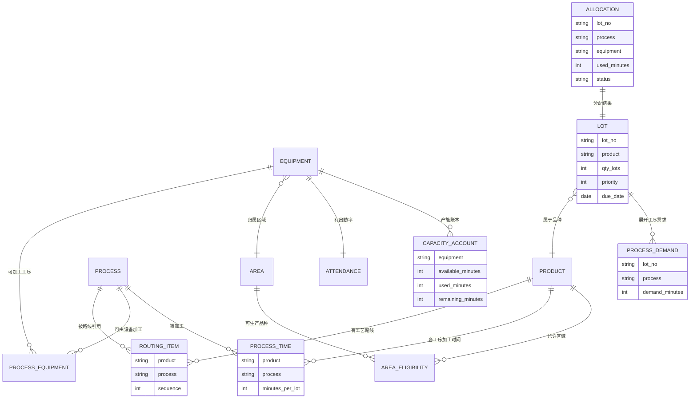
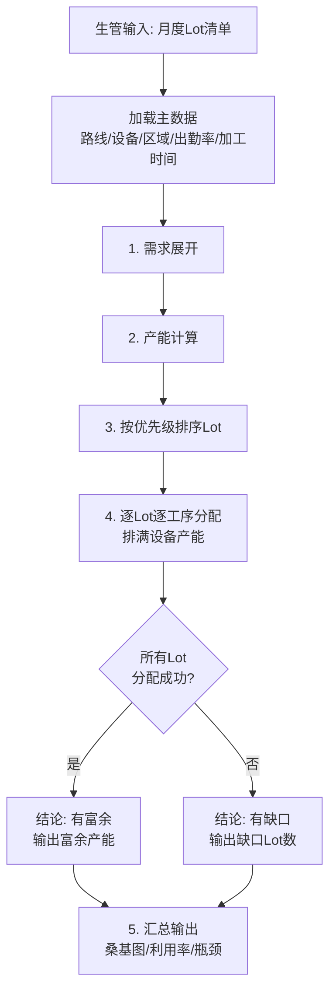
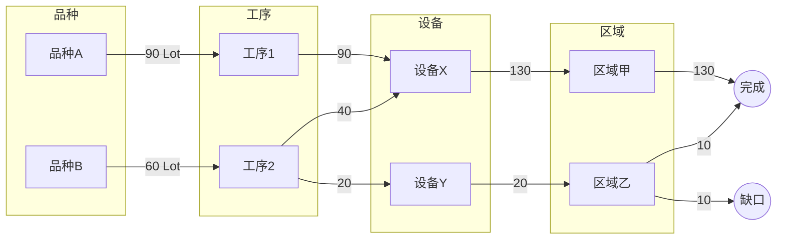

# 月度产能分配演算系统 —— 业务建模文档

> 版本：v1.1
> 日期：2026-11-24
> 依据：《原始需求.md》
> 变更记录：v1.1 —— 建模决策点 Q1–Q6 已与业务确认，结论固化进正文（详见 §7）
> 定位：本文档是需求与系统设计之间的桥梁，用业务语言描述系统的领域概念、对象模型、业务流程、业务规则与输出模型，作为后续数据表结构设计与算法设计的输入。

---

## 1. 业务背景与目标

### 1.1 业务背景

生管部门每月下达**整月 Lot 产量指标**，工厂需要在品种工艺路线、设备产能、区域限制、出勤率等多重约束下，事前验算：

- 这个月的指标**能不能完成**？
- 如果不能完成，**缺口有多大**（差多少个 Lot）？
- 产能**瓶颈**出现在哪台设备、哪个区域、哪道工序？

传统人工排产验算耗时且易错，需要一套**月度生产演算系统**将这一过程标准化、自动化、可视化。

### 1.2 系统目标

| 编号 | 目标 | 说明 |
|---|---|---|
| G1 | 整月产能验算 | 在全量约束下验算月度 Lot 指标是否可完成 |
| G2 | 缺口量化 | 无法完成时，输出无法完成的 Lot 数（含分维度明细） |
| G3 | 富余量化 | 可完成时，输出富余产能（分钟 / Lot 当量） |
| G4 | 分配可视化 | 以桑基图展示"品种→工序→设备→区域→完成/缺口"的分配流向 |
| G5 | 瓶颈识别 | 辅助输出设备/区域利用率、瓶颈清单，支撑产能决策 |

### 1.3 业务边界（In Scope / Out of Scope）

- **范围内**：月度粒度的产能验算与分配模拟（整月汇总口径，非日/班次排程）；静态主数据驱动的模拟演算。
- **范围外**：具体到天/小时的生产排程（细排程）、物料/人力/模具等其他资源约束、实时产能监控、成本核算。

---

## 2. 业务术语表（领域概念）

| 术语 | 英文/代号 | 定义 | 业务含义 |
|---|---|---|---|
| 品种 | Product | 产品的种类型号 | 工艺路线和加工时间的载体 |
| 工序 | Process | 生产中的一个加工步骤 | 工艺路线的组成单元 |
| 工艺路线 | Routing | 品种需依次经过的工序序列 | 决定 Lot 的流转路径 |
| Lot | Lot | 最小生产/分配单位，**不可拆分** | 分配的基本颗粒度 |
| 设备 | Equipment/Machine | 执行工序的物理资源 | 产能的载体 |
| 区域 | Area/Zone | 设备的物理/组织分组 | 品种有区域准入限制 |
| 出勤率 | Attendance Rate | 设备月度可用时间占日历时间的比例 | 折算设备实际可用产能 |
| 可用分钟 | Available Minutes | 月度日历分钟 × 出勤率 | 设备产能的度量单位 |
| 加工时间 | Processing Time | 某品种在某工序加工一个 Lot 所需分钟数 | 需求工时的度量单位 |
| 区域可加工性 | Area Eligibility | 品种只能在指定区域生产的限制 | 收窄设备候选范围 |
| 粗优先级 | Priority | 生管手动标记的重要/紧急程度 | 决定 Lot 占用产能的先后 |
| 排满 | Fill-to-Capacity | 优先将设备产能占满的分配策略 | 先占满再看富余/缺口 |
| 缺口 | Gap | 无法完成分配的 Lot 数 | 指标不可完成的量化 |
| 富余 | Surplus | 全部分配成功后的剩余产能 | 指标可完成的量化 |
| 瓶颈 | Bottleneck | 利用率接近/达到 100% 的设备/区域 | 产能决策的抓手 |

---

## 3. 业务对象模型

### 3.1 对象清单与职责

#### 3.1.1 主数据对象（静态，数据库维护）

| 对象 | 关键属性 | 职责 |
|---|---|---|
| 品种 | 品种编码、名称 | 标识产品种类 |
| 工序 | 工序编码、名称、序号 | 标识加工步骤 |
| 工艺路线（品种-工序） | 品种、工序、顺序号 | 定义品种的工序序列 |
| 设备 | 设备编码、名称、所属区域 | 标识加工资源 |
| 工序-设备对应 | 工序、设备 | 定义工序的可选设备集 |
| 设备出勤率 | 设备、出勤率 | 折算设备月度可用分钟 |
| 加工时间（品种-工序） | 品种、工序、分钟/Lot | 计算需求工时 |
| 区域可加工性（品种-区域） | 品种、区域（允许） | 限定品种的生产区域 |

#### 3.1.2 输入数据对象（动态，生管每月提供）

| 对象 | 关键属性 | 职责 |
|---|---|---|
| 月度 Lot 清单 | Lot 编号、品种、数量（Lot 数）、粗优先级、交期（可选） | 驱动整月验算的需求输入 |
| 演算月份/日历 | 月份、日历分钟 | 产能计算的时间基数 |

#### 3.1.3 演算过程对象（系统生成，过程态）

| 对象 | 关键属性 | 职责 |
|---|---|---|
| 工序需求 | Lot、工序、需求分钟 | 单 Lot 单工序的工时需求 |
| 设备可用产能 | 设备、可用分钟 | 设备月度产能池 |
| 区域可用产能 | 区域、可用分钟（= 区域内设备汇总） | 区域级产能约束 |
| 分配结果 | Lot、工序、设备、占用分钟 | 一次成功分配的记录 |
| 设备产能占用 | 设备、已用分钟、剩余分钟 | 产能消耗的滚动账本 |

#### 3.1.4 输出结果对象（系统生成，结果态）

| 对象 | 关键属性 | 职责 |
|---|---|---|
| 验算结论 | 总需求 Lot 数、可完成 Lot 数、结论（富余/缺口）、缺口 Lot 数 | 顶层结论 |
| 缺口明细 | 品种/工序/设备/区域、缺口 Lot 数 | 分维度缺口分析 |
| 利用率指标 | 设备/区域、已用/可用、利用率 | 瓶颈识别 |
| 桑基图数据 | 节点与边（层级固定） | 分配流向可视化 |

### 3.2 对象关系模型（ER 视角）



### 3.3 关键对象状态

**Lot（演算视角）**

```
待分配 ──分配成功──> 已完成
   │
   └─遍历所有候选设备/区域均无足够产能──> 缺口（未完成）
```

**设备产能账本（演算视角）**

```
空载(剩余=可用) ──占用──> 部分占用 ──持续占用──> 排满(剩余=0)
```

> 注意：一旦 Lot 的某道工序无法在任何候选设备分配成功，该 Lot 即标记为缺口，其已分配的前序工序产能占用**不回退**（Q1 已确认），保留部分占用痕迹。

---

## 4. 核心业务流程

### 4.1 端到端流程



### 4.2 子流程详解

#### P1 需求展开

- 输入：月度 Lot 清单 + 品种工艺路线 + 加工时间 + 区域可加工性
- 处理：
  1. 按品种展开每个 Lot 的工序序列（保持工序顺序）；
  2. 每道工序生成需求记录：`需求分钟 = Lot 数 × 该品种该工序单 Lot 加工时间`；
  3. 按品种-区域可加工性，计算每个 (品种, 工序) 的**候选区域集合**，再通过"工序-设备对应 + 设备-区域归属"得到**候选设备集合**。
- 输出：工序需求清单（含候选设备集合）
- 业务规则：若候选设备集合为空（该品种该工序无任何可用设备），该 Lot 与"产能不足"情形**同口径**判定为缺口（Q6 已确认），辅助标注原因"无可加工设备"供分析，不作为特殊分支。

#### P2 产能计算

- 输入：演算月份日历分钟 + 设备出勤率 + 设备-区域归属
- 处理：
  1. 每台设备：`可用分钟 = 月度日历分钟 × 出勤率`；
  2. 每个区域：`区域可用分钟 = Σ 区域内设备可用分钟`（区域产能仅作汇总约束/分析口径）。
- 输出：设备产能池、区域产能池（初始账本，剩余=可用）

#### P3 Lot 排序

- 排序键（Q5 已确认，三级排序）：
  1. **粗优先级降序**——生管意志的体现：重要/紧急的 Lot 先占稀缺产能；
  2. **Lot 数量降序**——同优先级时数量大的 Lot 先排（先大后小，利于榨干设备产能、减少产能碎片；方向为默认假设，见 §7 残留小项）；
  3. **Lot 编号升序**（保底）——保证演算结果稳定、可复现。
- 交期：仅作展示参考，不参与排序。

#### P4 分配与排满（核心演算）

对排序后的每个 Lot，依次处理其每道工序：

1. 取该工序的候选设备集合（已按区域可加工性过滤）；
2. 按"**先排满**"策略在候选设备中选择目标设备（选择策略见 §5.2）；
3. 校验该设备剩余产能是否 ≥ 本 Lot 该工序需求分钟（**整 Lot 校验，不可拆分**）：
   - 满足 → 分配成功，记账（设备已用分钟增加，剩余减少），继续下一道工序；
   - 不满足 → 尝试下一台候选设备；轮到该 Lot 时全部候选设备均已无法容纳（产能已被前序 Lot 榨干，或本就无候选设备）→ 该 Lot 判定**缺口**，停止其后续工序分配，**已占用的前序工序产能不回退**（Q1 已确认）；
4. Lot 的全部工序分配成功 → Lot 标记"完成"。

> 工序顺序的意义：Lot 按工艺路线依次经过工序。由于本系统是**整月汇总口径**（非时序排程），工序顺序主要影响需求展开的结构；**不模拟**"前工序完成后才能占用后工序产能"的时序依赖（Q2 已确认），时序问题留给细排程系统。

#### P5 结论与输出

- 所有 Lot 完成 → **有富余**：
  - 富余产能（分钟）= Σ 各设备剩余分钟；
  - 富余 Lot 当量 = 富余分钟 ÷（按品种/加权平均的加工时间），辅助口径。
- 存在缺口 Lot → **有缺口**：
  - 缺口 Lot 数 = 未完成 Lot 的数量（Lot 数口径，非需求分钟口径）；
  - 分维度汇总：品种 / 工序 / 设备 / 区域。
- 生成桑基图数据、利用率、瓶颈清单。

---

## 5. 业务规则

### 5.1 约束规则（硬约束，违反即分配失败）

| 编号 | 规则 | 类型 | 说明 |
|---|---|---|---|
| C1 | Lot 不可拆分 | 完整性 | 整 Lot 分配到一台设备，不跨设备/区域拆分 |
| C2 | 工序顺序 | 工艺 | Lot 按品种工艺路线依次经过各工序 |
| C3 | 工序-设备对应 | 能力 | 工序只能由其对应设备加工 |
| C4 | 品种-区域准入 | 能力 | 品种只能在允许区域内的设备上加工 |
| C5 | 产能上限 | 容量 | 设备累计占用 ≤ 月度可用分钟（日历分钟 × 出勤率） |
| C6 | 整 Lot 产能校验 | 容量 | 剩余产能必须一次性容纳整 Lot 的工序需求分钟 |
| C7 | 优先级次序 | 调度 | 高优先级 Lot 先占用产能（先到先得，不做抢占） |

**候选设备的完整过滤链：**

```
候选设备 = {设备 | 设备 ∈ 工序-设备对应(E)} 
         ∩ {设备 | 设备.区域 ∈ 品种允许区域(P)}
         - {设备 | 剩余产能 < 本Lot该工序需求分钟}   ← 逐台动态校验
```

### 5.2 策略规则（已确认，结论固化）

| 编号 | 策略 | 确认结论 | 依据 |
|---|---|---|---|
| S1 | 设备选择策略（"排满/榨干"语义） | **Best-Fit 榨干式贪心**：在候选设备中选"剩余产能 ≥ 需求且剩余最小"的设备，使设备产能被榨干排满。设备**不设优先级** | Q3、Q6 |
| S2 | 缺口 Lot 的已占用回退 | **不回退**：缺口 Lot 已占用的前序工序产能保留，计入设备已用分钟 | Q1 |
| S3 | 区域级产能上限 | **不设区域级独立硬上限**：仅设备级硬约束，区域产能作汇总分析 | Q4 |
| S4 | Lot 分配排序 | **优先级降序 → Lot 数量降序 → Lot 编号升序（保底）**；交期仅展示 | Q5 |

> 说明：**分配总目标 = 榨干设备产能**（Q6 确认）。"先把所有设备产能排满"落地为 Best-Fit 榨干式贪心（候选集中剩余产能最小且能容纳整 Lot 的设备）；**缺口的判定口径**即"轮到该 Lot 时，所有候选设备均已无法容纳"——产能被前序 Lot 榨干与品种无候选设备两种情形统一处理，均为缺口。

### 5.3 计算口径规则

| 编号 | 规则 |
|---|---|
| R1 | 工时单位统一为**分钟**，全程不换算为小时 |
| R2 | 时间粒度为**整月汇总**，不做日内/班次切分 |
| R3 | 设备可用分钟 = 演算月日历分钟 × 该设备出勤率 |
| R4 | 工序需求分钟 = Lot 数 × 该品种该工序加工时间（分钟/Lot） |
| R5 | 区域可用分钟 = 区域内设备可用分钟之和 |
| R6 | 缺口以 **Lot 数**为计量口径（非分钟） |
| R7 | 桑基图层级固定：品种 → 工序 → 设备 → 区域 → 完成/缺口 |

---

## 6. 输出模型

### 6.1 验算结论（业务报表口径）

| 输出项 | 口径 |
|---|---|
| 月度总需求 Lot 数 | Σ 输入清单中各 Lot 的数量 |
| 可完成 Lot 数 | 分配成功 Lot 的数量合计 |
| 验算结论 | 有富余（可完成指标）/ 有缺口（无法完成指标） |
| 缺口 Lot 数 | 总数 + 按品种/工序/设备/区域四维明细 |
| 富余产能 | 设备剩余分钟汇总（+ Lot 当量换算，辅助） |

### 6.2 桑基图（分配流向模型）

- **层级固定**：`品种 → 工序 → 设备 → 区域 → 完成/缺口`
- **边流量**：流经该路径的 **Lot 数**（建议主流量口径；分钟口径可作切换）
- **数据结构**：节点表（层级别 + 名称）+ 边表（源节点、目标节点、流量）
- **典型阅读方式**：
  - 从"缺口"节点反向追流 → 哪些品种/工序/设备贡献了缺口；
  - 边的粗细 → 直观定位瓶颈设备/区域。



> 示意：品种B 在工序2 需 60 Lot，设备Y 只消化 20 Lot，其中 10 Lot 完成、10 Lot 流向缺口（此处数字仅示意）。

### 6.3 辅助输出（分析口径）

| 输出项 | 计算方式 | 用途 |
|---|---|---|
| 设备利用率 | 已用分钟 / 可用分钟 | 识别瓶颈设备（利用率 100% 或近满） |
| 区域利用率 | 区域已用分钟 / 区域可用分钟 | 识别瓶颈区域 |
| 瓶颈清单 | 按利用率降序 + 缺口贡献排序 | 产能扩充/外协决策 |
| 优先级达成分析 | 各优先级层级的 Lot 完成率 | 验证高优先级策略有效性 |

---

## 7. 建模决策点确认结果（已与业务确认，2026-11-24）

| 编号 | 问题 | **确认结论** |
|---|---|---|
| Q1 | 缺口 Lot 已占用的前序工序产能是否回退？ | **不回退**——缺口 Lot 已占用的前序工序产能保留，计入设备已用分钟 |
| Q2 | 工序间是否需要时序依赖（前工序完成后才能占后工序产能）？ | **不考虑**——本系统是月度演算（整月汇总口径），时序留给细排程系统 |
| Q3 | "排满"的设备选择策略是否按设备优先级？ | **设备不设优先级**——采用 Best-Fit 榨干式贪心（选剩余最小且能容纳整 Lot 的设备） |
| Q4 | 区域级是否设独立产能硬上限？ | **不考虑**——仅设备级硬约束，区域产能作汇总分析 |
| Q5 | Lot 数量语义与分配排序？ | **各 Lot 数量可以不同**（数量 > 1）；分配排序：**优先级 → Lot 数量 → Lot 编号保底**；Lot 仍按整行不可拆分处理，需求分钟 = 数量 × 分钟/Lot |
| Q6 | 品种在某工序无任何候选设备时的处理？ | **标记为缺口**——以榨干设备产能为目标，轮到该 Lot 时已无设备可分配（产能被榨干或本就无候选设备），该 Lot 即为缺口，两种情形统一判定 |

> 残留小项：Q5 中"Lot 数量"排序方向默认取**降序**（大 Lot 先排，利于榨干产能、减少碎片）。若业务意图为升序（小 Lot 先排、多完成 Lot 数），仅需调整排序方向，不影响整体建模。

---

## 8. 用例视角（业务场景）

| 用例 | 角色 | 触发 | 主流程 | 结果 |
|---|---|---|---|---|
| UC1 月度产能验算 | 生管 | 每月导入 Lot 清单后 | 输入 → 展开 → 产能 → 分配 → 判断 | 富余/缺口结论 |
| UC2 缺口分析 | 生管/厂长 | 验算出现缺口 | 查看桑基图 + 分维度缺口明细 | 定位瓶颈，决策加班/外协/调指标 |
| UC3 优先级模拟 | 生管 | 调整 Lot 优先级重新演算 | 修改优先级 → 重跑 | 对比不同优先级方案下的完成率 |
| UC4 主数据维护 | 工艺/设备管理员 | 路线/设备/出勤率变化 | 维护主数据 | 影响后续验算口径 |
| UC5 出勤率模拟 | 生管/设备管理员 | 模拟加班/检修 | 调整出勤率 → 重跑 | 观察缺口是否收敛 |

---

## 9. 后续工作映射

| 建模产出 | 承接的下一步 |
|---|---|
| §3 对象模型 | 数据库表结构设计（主数据表 + 输入表 + 结果表） |
| §4/§5 流程与规则 | 分配算法详细设计（伪代码 → 实现） |
| §6.2 桑基图模型 | 桑基图节点/边数据结构设计与前端可视化选型 |
| §7 决策点 | 已全部确认（2026-11-24），结论已固化进 §5 规则；仅 Lot 数量排序方向可留作配置项 |

---

## 附录 A：一句话业务定义

> 以整月 Lot 产量为输入，统一以分钟为工时口径，在 Lot 不可拆分、工艺路线、工序-设备、设备-区域、出勤率、品种加工时间、区域准入、粗优先级八大约束下，按优先级先排满设备产能，从而判断月度指标能否完成——富余则可完成，缺口则量化未完成 Lot 数，并以"品种→工序→设备→区域→完成/缺口"桑基图呈现全链路流向。
